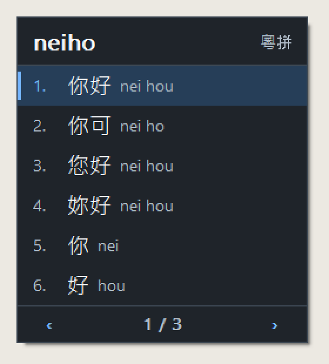
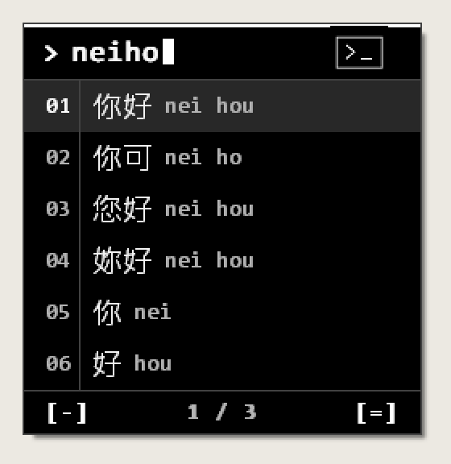
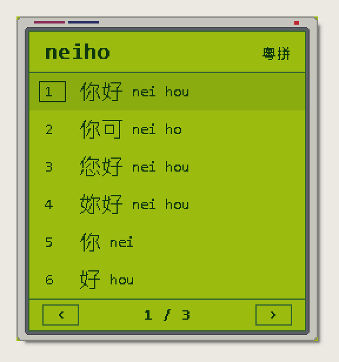
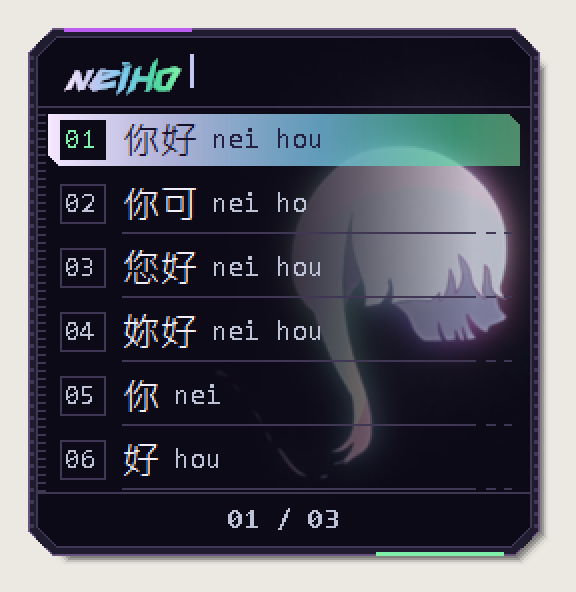
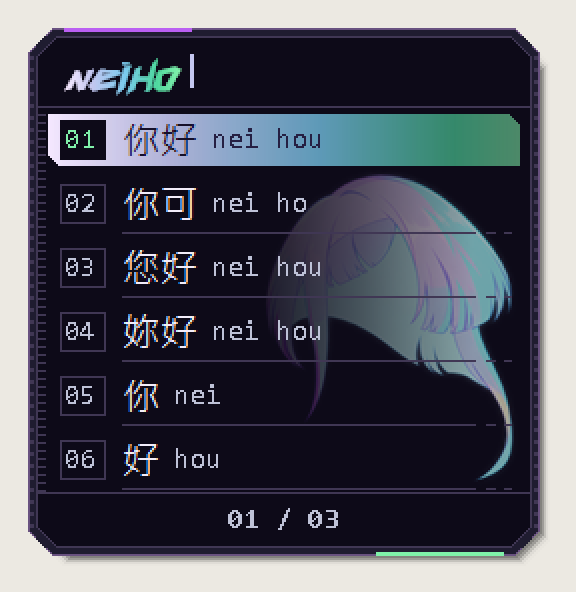
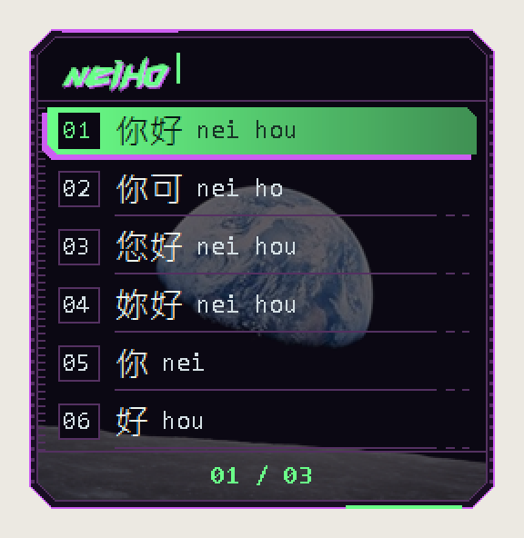
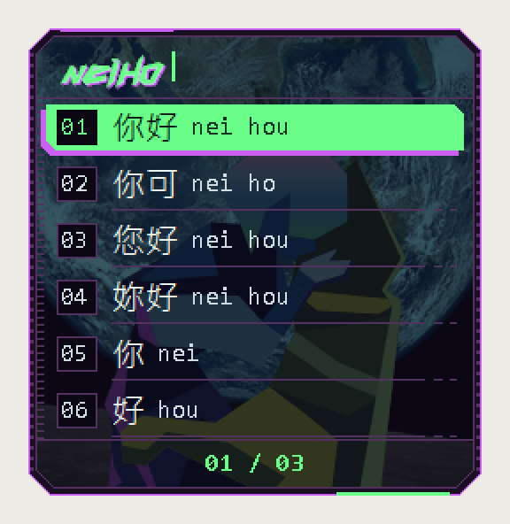
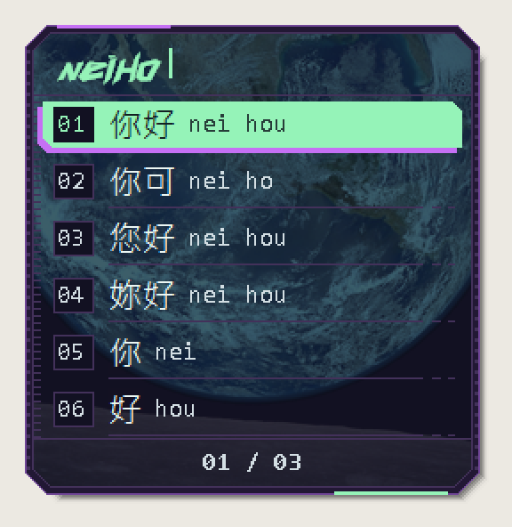
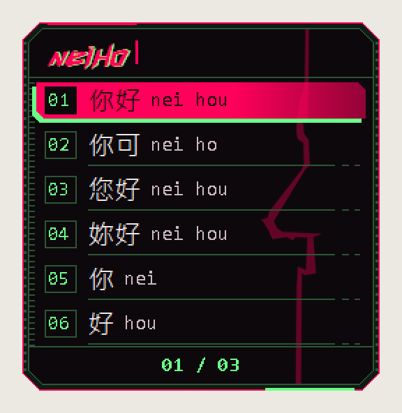
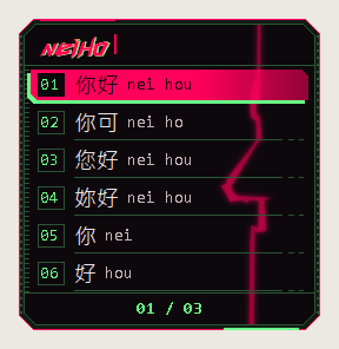

# 粵拼輸入法 · Yutping IME

一個適用於 Windows 10／11（x64）的粵拼輸入法。它透過 Windows Text Services Framework（TSF）在一般桌面程式輸入文字，向 Google Input Tools 的網路服務查詢繁體中文候選字。這是**非官方的獨立開源專案**，沒有使用或包含 Google Chrome 擴充功能的程式碼，也不隸屬於 Google。

> 目前仍是概念驗證版。建議先在記事本等一般程式試用；Google 服務或回應格式改變時，查字功能可能失效。

## 下載與安裝

1. [直接下載 Windows 安裝程式](https://github.com/eddylaucheukwa-cloud/yutping-ime/raw/main/dist/YutpingSetup.exe)（`YutpingSetup.exe`）。更新時亦可執行同一個檔案，原有設定會保留。
2. 雙擊 EXE，接受 Windows 管理員權限提示。程式會註冊輸入法、在需要時加入「中文（繁體，香港）」語言，並把 Yutping 加入目前使用者的鍵盤清單；原有語言及鍵盤設定會保留。
3. 關閉並重開想使用輸入法的程式，按 `Win + Space` 選擇「粵拼輸入法 (Yutping IME)」。如果仍顯示舊版，請先儲存工作，從 Windows **登出再登入**。已開啟的程式可能仍把舊 DLL 留在記憶體；毋須反覆安裝。

安裝程式未有數碼簽署，Windows 可能顯示「未知發行者」警告。只支援 64 位元應用程式。解除安裝可到「設定 → 應用程式 → 已安裝的應用程式」選擇 **Yutping IME**。

### 安裝後退回 US／無法輸入中文

請先在 Windows 記事本測試，分辨是輸入法從選單消失／退回其他鍵盤，還是仍選中 Yutping 但沒有候選字。下載 [診斷工具 ZIP](https://github.com/eddylaucheukwa-cloud/yutping-ime/raw/main/dist/YutpingDiagnostics.zip)，解壓縮後雙擊 `YutpingDiagnostics.cmd`，毋須管理員權限。將桌面的 `YutpingDiagnostics.txt` 附在 GitHub issue，並說明使用哪個應用程式及重現步驟。

工具只讀取系統版本、語言／輸入法設定、註冊位置、DLL 架構／簽署及近期與 Yutping 有關的錯誤，並在自己的程序測試 COM 載入。新版輸入法亦會把啟用階段及錯誤代碼記錄在 `%LOCALAPPDATA%\YutpingIME\activation.log`（約 64 KB 後重新記錄），診斷工具會附上最近紀錄。報告包含本機安裝路徑，不收集打字內容、不連接網路、不改動輸入法設定。COM 載入成功不代表目標應用程式一定能啟用輸入法。若 Windows 的安全政策拒絕載入，需依實際錯誤處理；請勿為此關閉安全功能。

## 如何使用

例如輸入 `neiho`：按 `Space` 選第一個中文候選字（通常是「你好」）；按 `Enter` 則直接輸出原本輸入的 `neiho`。

亦可分段選字：輸入 `neiho`，選「你」後會保留 `ho`，繼續選「好」即可。未選的拼音會留在同一個候選視窗，不會整段清空。候選字會受本機常用字排序影響，請按畫面所示編號選字。

查字尚未完成時按 `Space`，程式會等候該次結果，保留之後輸入的字母，依次處理；不會因網路較慢而自動輸出英文。沒有候選結果時拼音會留待修改，也可按 `Enter` 輸出原文。快速輸入的查詢會合併，並重用網路連線；實際速度仍受網路及 Google 服務影響。

命中有效本機快取時，候選字會立即顯示，不再等待查詢計時器或另一輪視窗訊息。啟用輸入法後，程式會在背景向 Google 發出一次不帶輸入文字的 HEAD 請求，預先準備連線；查字支援 HTTP/2，同一程序內相同拼法的進行中查詢會共用一個請求。未載入完成時按 Space，選字窗會顯示「已收到選字 · 等候中」，查字回覆後自動完成選字。這些改動不能消除首次網路連線及遠端服務的延遲。

| 操作 | 按鍵 |
| --- | --- |
| 輸入粵拼 | `A`–`Z`；`'` 分隔音節 |
| 揀選當頁候選字 | `1`–`9`（按當頁編號）或滑鼠點選 |
| 下一頁／上一頁 | `=`／`-`、`.`／`,`、`]`／`[`、`Page Down`／`Page Up`、右／左方向鍵 |
| 逐項移動選字高亮 | 下／上方向鍵；到頁尾／頁首後才跨頁，到整份清單兩端時停留 |
| 確認高亮候選字 | `Space`；翻頁後預設高亮當頁第一個字 |
| 輸出原始粵拼 | `Enter` |
| 刪除／取消組字 | `Backspace`／`Esc` |
| 切換中英文模式 | 單獨按 `Ctrl + Shift`，放開其中一鍵時切換；可在設定改為 `F12` |

候選窗會在組字期間顯示拼法、候選字和讀音註記；查詢下一個拼法時，舊候選字會暫時淡化，避免視窗每打一個字就消失。候選窗跟隨 Windows 應用程式的深色／淺色模式。中文模式下，一般標點符號會轉換為中文標點。

未組字時，單引號鍵 `'` 輸出 `《`，雙引號鍵 `"`（Shift + 單引號）輸出 `》`；`[`／`]` 仍為 `「`／`」`，`{`／`}` 為 `『`／`』`。組字中的單引號保留分隔音節的用途。英文模式或關閉中文標點時，標點鍵會照常交給應用程式。

在開始功能表開啟「**粵拼輸入法設定**」，可選每頁顯示 4／6／9 個候選字、開關中文標點和常用字排序、選擇 Ctrl + Shift 或 F12 切換鍵，也可清除快取及常用字紀錄。這些設定適用於新輸入，毋須重新啟動電腦。

亦可選擇選字窗主題，按「**預覽主題**」比較外觀，然後儲存。預覽不會查詢網路或改動目前輸入的文字。

### 主題一覽

<table>
<tr>
<td align="center"><br><b>System (match Windows)</b></td>
<td align="center"><br><b>Terminal</b></td>
<td align="center"><br><b>Game Boy</b></td>
<td align="center"><br><b>Lucy · Afterglow</b></td>
</tr>
<tr>
<td align="center"><br><b>Lucy · Flow</b></td>
<td align="center"><br><b>David &amp; Lucy · Earthrise</b></td>
<td align="center"><br><b>David &amp; Lucy · Embrace</b></td>
<td align="center"><br><b>David &amp; Lucy · Blue Marble</b></td>
</tr>
<tr>
<td align="center"><br><b>Capri · Redline</b></td>
<td align="center"><br><b>Capri · Redline — Typing Glow</b></td>
</tr>
</table>

以上為實際選字窗的截圖（`System` 會跟隨 Windows 的深色／淺色模式，圖中為深色）。

| 主題 | 外觀 |
| --- | --- |
| System (match Windows) | 原有簡約介面，自動切換深色／淺色；右上角保留「粵拼」 |
| Terminal | 純黑白灰的等寬輸出、提示符與區塊游標、行號欄及 `[-]`／`[=]` 翻頁提示；右上角為黑白 `>_` 小終端圖示 |
| Game Boy | 縮小的 DMG 螢幕邊框、四色 LCD、電源燈及方框選字標記；右上角保留「粵拼」 |
| Lucy · Afterglow | Lucy 的髮色漸變（淡紫 → 冰藍 → 薄荷綠）用於輸入欄英文及選字高亮；高亮由左至右從 100% 淡至 55% 不透明，讓背景透出；髮絲原圖以 85% 強度、濾色（screen）方式顯示於右側，左側以深色漸層保護文字 |
| Lucy · Flow | 同上設計，背景改用飄逸髮絲圖，顯示強度 70% |
| David & Lucy · Earthrise | Earthrise 背景放大至 105%、不透明度 35%；輸入英文為 `#6AFF88` 綠色，最外框、英文細陰影與高亮左下殘影為 `#CD5EF2` 紫色 |
| David & Lucy · Embrace | 擁抱人物 22%、大型地球照片 32%，背景延伸至頂欄及頁數欄；高亮與 Earthrise 相同 |
| David & Lucy · Blue Marble | 與 Embrace 相同的大型地球，移除背景人物 |
| Capri · Redline | `#FF005A` 紅色輸入英文、最外框及選字高亮（左側實色，右側逐漸淡至 55% 不透明度），配 `#6AFF88` 細綠字影、編號、頁碼與高亮殘影；背景為 VectorCraft 重構的紅色閃電，35% 不透明度，只有輸入時啟動 Glow |

兩款 Lucy、三款 David & Lucy 及 Capri 共用同一套 Edgerunner 外框：四角削邊（視窗本身亦按削角裁切，角位透明）、內框四角同樣削邊、兩側刻度線、上下各一條長色帶；頂欄只顯示輸入的英文及游標，不顯示主題圖示；候選字編號沿用原有點陣（無反鋸齒）Consolas 字體及方框，選中時編號轉為綠色（Capri 編號始終為綠色）；頁尾只顯示頁碼，左右兩側仍可點擊翻頁，鍵盤 `-`／`=` 亦可。

主題以選字和減少遮擋為優先。Capri 只在輸入字母、分隔符或刪字時亮起柔和 Glow，停字 500 毫秒、關閉選字窗或失去輸入焦點後熄滅；翻頁、移動選字及候選更新不觸發光效，沒有 Glare、掃光或閃爍。六個候選字時，各主題視窗均不超過 256 × 278 像素。4／6／9 個候選字使用相同字體大小，視窗按列數調整高度；背景保持固定大小與上方位置，候選字減少時從底部裁切。背景、選字高亮及輸入欄漸變只在主題或尺寸改變時產生一次；Capri 預先快取靜止與 Glow 兩張背景，按鍵只切換快取及重設熄光計時器，不會逐鍵解碼或模糊圖片。候選區小字對比、版面尺寸、視窗削角及滑鼠選字／翻頁均有自動檢查。

兩款 Lucy、三款 David & Lucy 及 Capri 的**頂部輸入英文**使用內嵌的自訂字體，保留核准的緊湊字距。字體只載入目前程式，不需安裝到 Windows，也不會改變其他應用程式輸出的字體。

David 主題、Neon Arcade 及 Paper & Ink 已移除；舊設定若選用這些主題，更新後會回到「System (match Windows)」，其他主題設定保留。

削角及分段框線參考 [Cyberpunk 2077 官方介面示例](https://www.cyberpunk.net/en/news/49591/update-2-1-accessibility-features)。Lucy 背景使用使用者提供的動畫髮絲原圖及其修復版本；David & Lucy 背景使用 NASA／Bill Anders 的 [Apollo 8 Earthrise](https://science.nasa.gov/resource/apollo-8s-iconic-earthrise/) 及 NASA 的 Blue Marble 照片，屬藝術構圖，非原照片的地球視角大小。圖片內嵌於安裝程式及輸入法，無須另外下載。來源與使用說明見 [圖片鳴謝](assets/ATTRIBUTION.md)。

### 本次更新

- 新增 Capri · Redline：紅綠配色、重構閃電背景及僅打字時啟動的 Glow（無 Glare）；綠色字影收窄成貼近紅字右側的細邊；選字高亮右側參考 Lucy 淡至 55% 不透明度，左側文字區與綠色殘影保持實色。
- David & Lucy 及 Capri 的頁碼維持 `#6AFF88` 綠色。
- David & Lucy 三款主題：更新綠紫配色、英文細陰影及紫色最外框；Earthrise 背景改為 105%／35%，小字配色同步調亮以保持清晰。
- 主題名稱改為英文：System (match Windows)、Terminal、Game Boy、Lucy · Afterglow、Lucy · Flow、David & Lucy · Earthrise、David & Lucy · Embrace、David & Lucy · Blue Marble。
- 移除 David 主題（原設定會回到 System）。
- Lucy 與 David & Lucy 改用新的 Edgerunner 外框：視窗四角削邊並透明裁切、內框削角、上下長色帶，移除頂欄及頁尾圖示。
- Lucy：髮色漸變高亮由左至右淡出；背景髮絲提高至 85%（Afterglow）／70%（Flow），並以深色漸層保護文字。
- David & Lucy：薄荷綠實色高亮配左下紫色殘影；Earthrise 移除地球／月球翻頁圖示。
- 候選字編號恢復原有點陣字體及方框，選中時轉為綠色。
- 選字視窗的功能、按鍵、尺寸及點擊範圍不變。

單按 Shift 或使用 Ctrl + Shift + 其他鍵不會切換模式。等待查字時也可以切換：尚未選字的粵拼會保留為英文，之後排隊的輸入會依次處理，舊查字結果不會再改寫文字。若 Windows 把 Ctrl + Shift 設為切換輸入語言，系統可能先處理這個組合鍵；可更改 Windows 的進階鍵盤快捷鍵，或在本輸入法設定改用 F12。

## 遊戲及其他操作畫面

輸入法會依 Windows TSF 提供的焦點和文字輸入狀態自動判斷，沒有使用遊戲名稱清單。在沒有文字輸入 context、唯讀、鍵盤輸入被停用，或 context 已失去連接時，會隱藏候選窗、取消待處理的轉換並放行操作鍵。目標程式拒絕建立組字或寫入文字時，也會放行該次字母及標點按鍵。回到可編輯的聊天輸入框後，中文輸入可繼續使用。

這個判斷依賴目標程式正確提供 TSF 狀態，無法保證識別所有遊戲自製的聊天框／操作畫面。若遊戲一直回報可編輯狀態，可按 Ctrl + Shift 手動切換英文模式以放行操作；若遊戲不提供 TSF 聊天輸入支援，本輸入法亦無法替它建立中文輸入功能。

## 網路與資料

輸入的粵拼會傳送到 Google Input Tools 服務以取得候選字。候選結果會在目前 Windows 使用者的本機登錄檔快取七日；過期後會重新查詢，斷線時只能使用已有的快取。常用字選擇紀錄亦只存於本機。可隨時在設定視窗清除兩種資料。本專案沒有內建完整離線詞庫。

## 從原始碼編譯

需要 Visual Studio 2022（含 C++ 桌面開發工具）、Windows SDK 和 CMake 3.20 或更新版本。在 **x64 Developer Command Prompt for VS 2022** 中執行：

```bat
cmake -S . -B build -G "Visual Studio 17 2022" -A x64
cmake --build build --config Release
ctest --test-dir build -C Release --output-on-failure
```

編譯後會產生 `dist\YutpingSetup.exe`。CMake 亦會產生內容相同的 `YutpingUpdate.exe` 供本機使用；公開下載只需一個 EXE。若目前 Windows 已載入舊 DLL，編譯時可改用另一個全新的 build 目錄，避免檔案被佔用。

## 已知限制

- 只提供 x64 DLL；32 位元程式尚未支援。
- 沒有數碼簽署、自動更新或完整離線字庫。
- 候選窗位置取決於目標程式提供的 TSF／Windows 插入點座標；某些程式可能無法準確定位。
- AppContainer、Windows 搜尋的候選字整合尚未支援；受限應用程式可能無法載入輸入法或連接查字服務。一般桌面程式的測試結果不能代表這些環境。
- Google 服務不是本專案所控制；網路服務、可用性和候選結果隨時可能改變。

## 網路、第三方服務與私隱

本輸入法目前依賴 Google Input Tools 的網路服務產生中文候選字。
當使用者以中文模式輸入粵拼時，正在組字的粵拼字串會透過 HTTPS 傳送至 `inputtools.google.com`，以取得候選結果。因此，本輸入法並不是完全離線的輸入法。
本專案本身不設伺服器，不會把輸入內容傳送給專案作者，亦不會建立使用者帳戶或收集遙測資料。候選字快取及常用字選擇紀錄只儲存在目前 Windows 使用者的本機。
然而，傳送至 Google 的資料會受到 Google 自己的服務條款及私隱政策約束。本專案無法控制 Google 如何處理其服務所接收的網路請求。
本專案並非 Google 官方產品，沒有獲 Google 贊助、認可或隸屬於 Google。Google Input Tools 是由 Google 提供的第三方服務，本專案並不保證該服務會持續提供、保持相同接口，或允許第三方客戶端永久存取。
如你不希望正在輸入的粵拼傳送至第三方網路服務，請不要使用目前版本的網路候選字功能。

## 授權

請參閱 [LICENSE](LICENSE)。
圖片及自訂字體另見 [素材來源說明](assets/ATTRIBUTION.md)，不包含在程式碼的 MIT 授權內。
